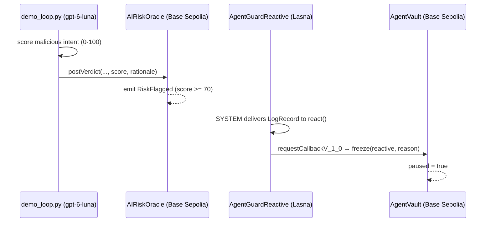

# AgentRiskGuard

**Reactive Omni Buildathon — Reactive Meets AI track**

On-chain spend-policy vault for autonomous agents, guarded by an **AI risk oracle** and a **Reactive Network** freeze callback.

> Origin event (`RiskFlagged` on Base Sepolia) → Lasna `react()` → Base Sepolia `AgentVault.freeze()`.

## Problem

Autonomous agent wallets can be jailbroken or given malicious intents ("drain vault", "disable limits"). Static per-tx caps help, but they cannot interpret *intent*. AgentRiskGuard adds an AI scorer in the live loop: high-risk intents are flagged on-chain and a Reactive contract freezes the vault before (or right after) abuse.

## Architecture



| Contract | Chain | Role |
|---|---|---|
| `AIRiskOracle` | Base Sepolia (84532) | Poster posts AI verdicts; emits `RiskFlagged` |
| `AgentGuardReactive` | Reactive Lasna (5318007) | Subscribes to `RiskFlagged`; callbacks `freeze` |
| `AgentVault` | Base Sepolia | ETH custody + `maxPerTx`; inherits `AbstractCallback` |

Uses the **Omni** Solidity library (`SYSTEM.subscribe` / `requestCallbackV_1_0`, `AbstractReactive` / `AbstractCallback`, Solidity `^0.8.29`) — not the legacy `service`/`vm` API.

## Networks

- **Base Sepolia**: RPC `https://sepolia.base.org`, callback proxy `0x476F44b11F5C942c58f4c8E3d0300E5710743585`
- **Reactive Lasna**: RPC `https://lasna-rpc.rnk.dev/`, explorer https://lasna.reactscan.net/, system `0x8888…8888`
- **lREACT faucet**: `request(address)` on `0x2afaFD298b23b62760711756088F75B7409f5967` (send Base Sepolia ETH)

## How to demo

```bash
export PATH="/home/box/.foundry/bin:$PATH"
forge build && forge test

# After Base Sepolia ETH is on the burner:
./scripts/deploy.sh
python3 scripts/demo_loop.py
```

`demo_loop.py` calls `gpt-6-luna` to score a malicious intent, posts the verdict on-chain, and polls until `AgentVault.paused() == true`.

## Deployed addresses

See [`deployments/lasna-base-sepolia.json`](./deployments/lasna-base-sepolia.json) (filled after a successful testnet deploy). Full-loop tx hashes are recorded there and in `deployments/demo_loop_result.json`.

## Security notes

- Burner keys only; never commit `.env` / private keys.
- `freeze` requires both `onlyServiceProvider` (callback proxy) and `onlyCallbackSender` (Lasna reactive).
- AI is part of the **running system** (live scoring), not just used to write the code.

## License

MIT
