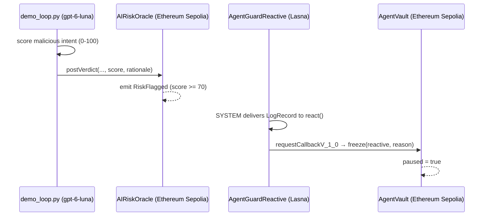

# AgentRiskGuard

**Reactive Omni Buildathon — Reactive Meets AI track**

On-chain spend-policy vault for autonomous agents, guarded by an **AI risk oracle** and a **Reactive Network** freeze callback.

> Origin event (`RiskFlagged` on **Ethereum Sepolia**) → Lasna `react()` → Sepolia `AgentVault.freeze()`.

Reactive Meets AI allows any Reactive-supported chain. Base Sepolia was preferred initially but public faucets were gated on mainnet ETH, so origin/destination is **Ethereum Sepolia**.

## Problem

Autonomous agent wallets can be jailbroken or given malicious intents ("drain vault", "disable limits"). Static per-tx caps help, but they cannot interpret *intent*. AgentRiskGuard adds an AI scorer in the live loop: high-risk intents are flagged on-chain and a Reactive contract freezes the vault before (or right after) abuse.

## Architecture



| Contract | Chain | Role |
|---|---|---|
| `AIRiskOracle` | Ethereum Sepolia (11155111) | Poster posts AI verdicts; emits `RiskFlagged` |
| `AgentGuardReactive` | Reactive Lasna (5318007) | Subscribes to `RiskFlagged`; callbacks `freeze` |
| `AgentVault` | Ethereum Sepolia | ETH custody + `maxPerTx`; inherits `AbstractCallback` |

Uses the **Omni** Solidity library (`SYSTEM.subscribe` / `requestCallbackV_1_0`, `AbstractReactive` / `AbstractCallback`, Solidity `^0.8.29`) — not the legacy `service`/`vm` API.

## Networks

- **Ethereum Sepolia**: chainId `11155111`, RPC `https://ethereum-sepolia-rpc.publicnode.com` (fallback `https://1rpc.io/sepolia`), callback proxy `0xAa14d9Cd0f788Ca23d11805986C1d8bd035D23b4`
- **Reactive Lasna**: chainId `5318007`, RPC `https://lasna-rpc.rnk.dev/`, explorer https://lasna.reactscan.net/, system `0x8888…8888`
- **lREACT faucet (on Sepolia)**: `request(address)` on `0x9b9BB25f1A81078C544C829c5EB7822d747Cf434` (send Sepolia ETH; e.g. 0.015 ETH → 1.5 lREACT)

## How to demo

```bash
export PATH="/home/box/.foundry/bin:$PATH"
forge build && forge test

# After Ethereum Sepolia ETH is on the burner:
./scripts/deploy.sh
python3 scripts/demo_loop.py
```

`demo_loop.py` calls `gpt-6-luna` to score a malicious intent, posts the verdict on-chain, and polls until `AgentVault.paused() == true`.

Env overrides for deploy: `ORIGIN_RPC`, `CALLBACK_PROXY`, `LREACT_FAUCET`, `ORIGIN_CHAIN_ID`, `FAUCET_VALUE`, `REACT_VALUE`, `VAULT_VALUE`.

## Deployed addresses

See [`deployments/lasna-sepolia.json`](./deployments/lasna-sepolia.json) (filled after a successful testnet deploy). The older `lasna-base-sepolia.json` name is superseded. Full-loop tx hashes are recorded there and in `deployments/demo_loop_result.json`.

## Security notes

- Burner keys only; never commit `.env` / private keys.
- `freeze` requires both `onlyServiceProvider` (callback proxy) and `onlyCallbackSender` (Lasna reactive).
- AI is part of the **running system** (live scoring), not just used to write the code.

## License

MIT
